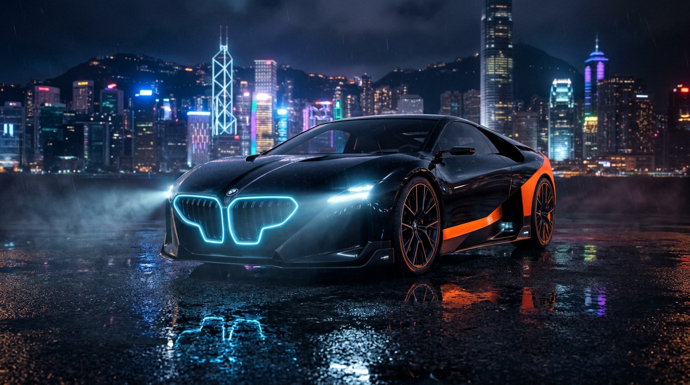

# BMW NEXUS — The Future of Intelligent Mobility

> **An ultra-premium, futuristic automotive web application and 3D experience built with Next.js 14, React, TypeScript, Tailwind CSS, Three.js, and Web Audio API.**



---

## ⚡ Tech Stack Implemented

- **Framework**: [Next.js 14 (App Router)](https://nextjs.org/)
- **UI & Architecture**: React 18, TypeScript, Tailwind CSS
- **3D Visualization**: [Three.js](https://threejs.org/) (Interactive 3D WebGL car stage, dynamic metallic paint shaders, real-time lighting rig, orbit & touch controls)
- **Audio Synthesizer**: Web Audio API (Synthesized low-frequency 55Hz EV purr and resonant glass HUD chimes)
- **Icons & Animation**: Lucide React, Glassmorphism, Tailwind Glow Effects & Keyframes
- **Deployment**: Vercel-ready production build (`npm run build` verified)

---

## 🎨 Visual Identity & Architecture

- **Visual Theme**: Cinematic dark futuristic night atmosphere, wet reflective asphalt tarmac with specular neon refractions, distant mountains, and cyberpunk skyline.
- **Color Palette**:
  - `Midnight Obsidian`: `#02040a`
  - `Deep Horizon Navy`: `#060c1e`
  - `Electric BMW Blue`: `#0066ff`
  - `Cyber Matrix Cyan`: `#00f0ff`
  - `Velvet Neon Purple`: `#8b5cf6`
- **Typography**: Space Grotesk (Futuristic geometric display headings) & Plus Jakarta Sans (Precision telemetry & controls).

---

## 🛸 Page Sections & Components

### 1. Navigation (`components/Navigation.tsx`)
- Glowing BMW Roundel logo and brand identity.
- Quick navigation links: *Overview*, *Design*, *Performance*, *Technology*, *Interior*, *Colors*, and *360° View*.
- Dual-mode presentation toggle: **Concept UI** (Ultra-res render) vs **3D Orbit** (Real-time WebGL).
- Cockpit Audio Engine toggle button with live status indicator.
- Glowing gradient *Build Yours* CTA button.

### 2. Main Hero Stage (`app/page.tsx` & `components/Canvas3D.tsx`)
- Central stage with low-angle front three-quarter view of the futuristic metallic black BMW concept car.
- Illuminated crystalline kidney grille with cyan LED contouring and razor-sharp laser matrix headlights.
- Large Hero Display: **BMW NEXUS**, subtitle *Luxury Meets Intelligence*, tagline *“More than a car. It's a feeling.”*
- Telemetry badges: Aerodynamic drag $0.198\text{ Cd}$, $800\text{V}$ Solid-State platform, Nexus Neural L4 AI Co-Pilot.

### 3. Floating Glassmorphic HUD Panels (`components/FloatingHudPanels.tsx`)
1. **01 / Iconic Design**: Active kinetic grille with biometric shutter matrix & laser optics.
2. **02 / Power & Performance**: Dual M eDrive motors delivering **1,020 HP**, **0-60 in 2.1s**, and **210 mph** top speed.
3. **03 / Smart Technology**: Neural iDrive 9 with quantum AR HUD and L4 autonomous driving.
4. **04 / Advanced Battery**: **135 kWh** Solid-State pack, **620 miles** driving range, 800V fast-charging (10-80% in 12m).
5. **05 / Luxury Interior**: Zero-gravity executive Merino seats with kinetic massage and electrochromic star-canopy.

### 4. Right Interactive Sidebar (`components/ConfiguratorSidebar.tsx`)
- **Choose Your Style**:
  - Exterior Finish: *Frozen Carbon Black*, *M Tanzanite Electric Blue*, *Cyber Cyan Metallic*, *Velvet Purple Neon*, *Frozen Pure Alpine*.
  - Wheels: *22" Aero V-Spoke*, *23" Carbon Jet Turbine*, *22" M Frozen Star*.
  - Interior: *Silverstone Merino Black*, *Alcantara Night Blue*.
  - Live calculated MSRP breakdown ($148,500 base) with 3-year supercharging warranty.
  - *Build Your BMW* modal trigger & Reset options.

### 5. Bottom Feature Dock (`components/BottomFeatureDock.tsx`)
- Quick feature modal inspect for:
  - *Adaptive LED Lights*
  - *Air Suspension (Active 2-Axle SkyRide)*
  - *Premium Sound (Bowers & Wilkins 4D Diamond)*
  - *Driver Assistance (Nexus Auto-Pilot L4)*
  - *Panoramic Sky Lounge (Electrochromic Roof)*

### 7. BMW Nexus AI Co-Pilot (`components/NexusAICoPilot.tsx`)
- Floating Holographic AI Orb with pulsing neural particle core.
- Voice-enabled multimodal conversational agent using Web Speech API (speech recognition mic input + vocal speech synthesis).
- Real-time vehicle control:
  - *"Change color to Cyber Cyan / Purple / Black / Blue / White"* ➔ Dynamically recolors the vehicle.
  - *"Engage track mode"* ➔ Stiffens telemetry and switches headlights/grille to aggressive purple glow.
  - *"What is the top speed and range?"* ➔ Delivers instant vocal and telemetry feedback (1,020 HP, 210 mph, 620 miles).
  - *"Switch to 3D Orbit view"* ➔ Toggles 3D WebGL mode.
  - *"Build & price this BMW"* ➔ Opens configurator reservation modal.
- Animated dynamic audio waveform visualizer when AI speaks.

---

## 🚀 Running the Project

### Development Server
```bash
npm run dev
```
Open [http://localhost:4000](http://localhost:4000) in your browser.

### Production Build
```bash
npm run build
npm run start
```
Open [http://localhost:4000](http://localhost:4000) in your browser.
